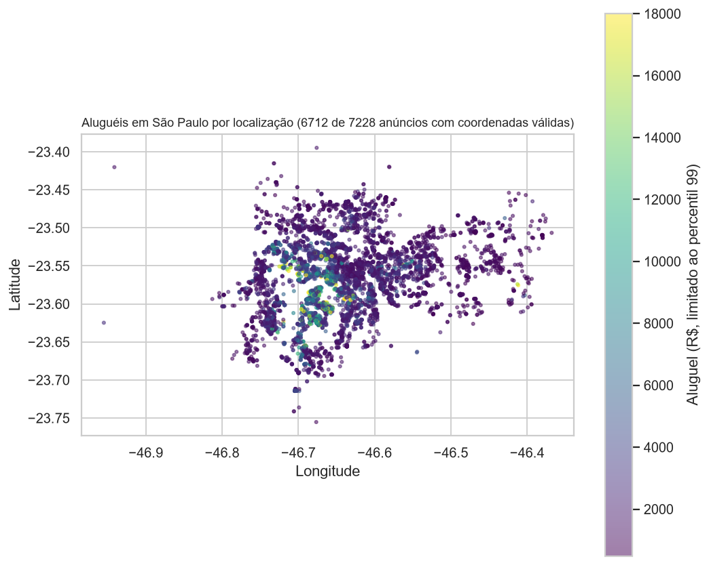
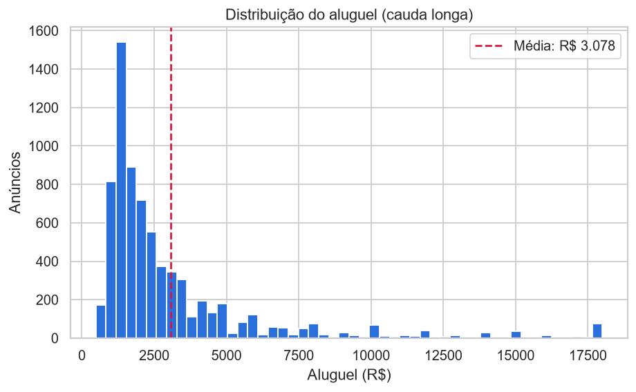
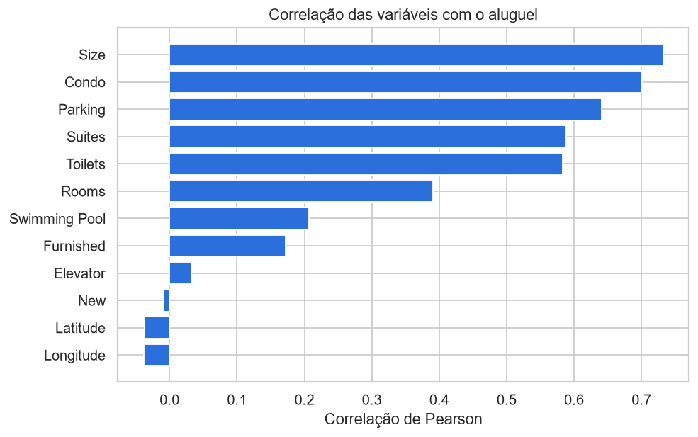
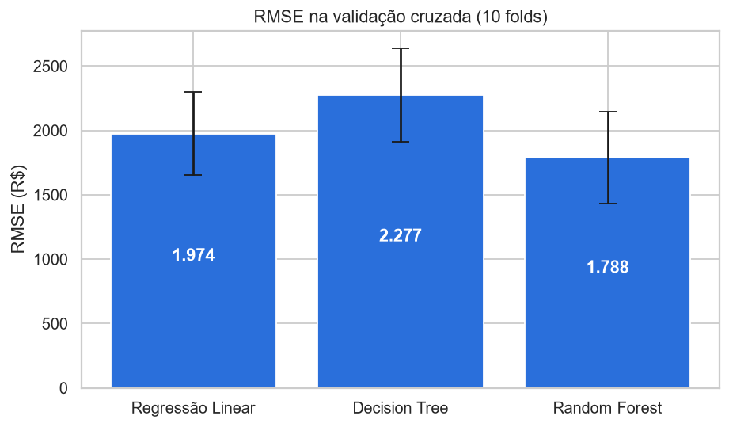
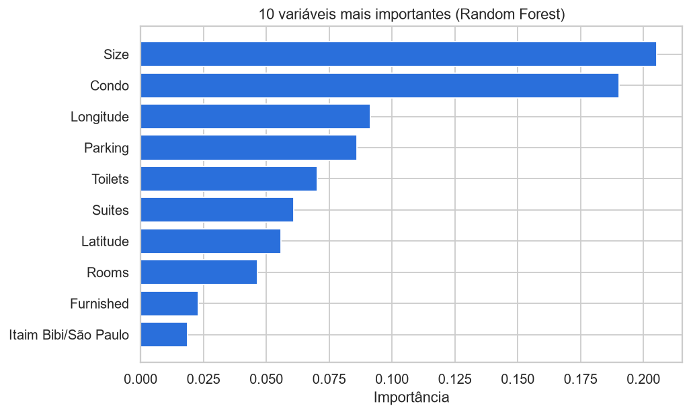
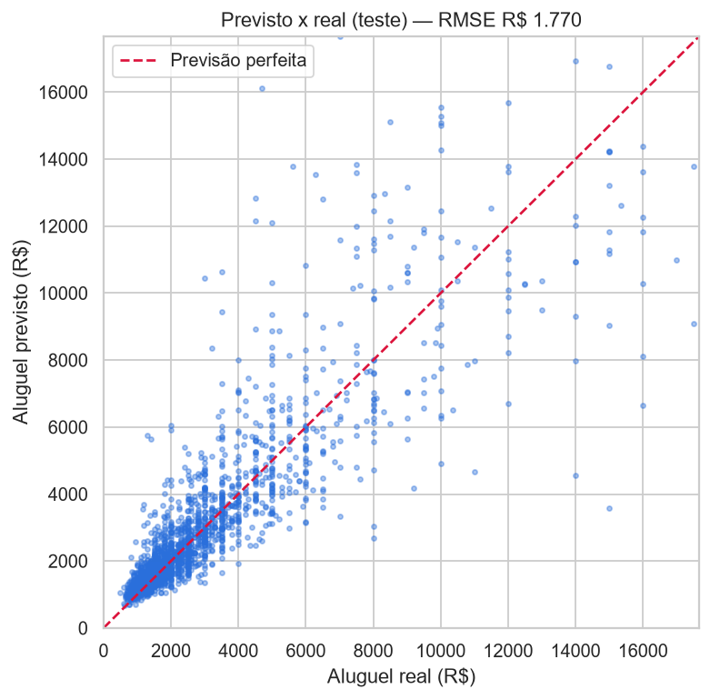

# Previsão de Preços de Aluguel de Apartamentos em São Paulo com Machine Learning

Projeto de regressão end-to-end seguindo o checklist de projetos de ML: análise exploratória, preparação dos dados, comparação de modelos, validação cruzada e ajuste de hiperparâmetros.

## Dados
`sao-paulo-properties-april-2019.csv` — anúncios de imóveis de São Paulo (abril/2019) com preço, condomínio, área, quartos, banheiros, suítes, vagas, elevador, mobília, piscina, bairro e coordenadas. O projeto usa apenas anúncios de **aluguel**.

## Metodologia
1. **Exploração** — mapa interativo (Plotly/Mapbox) de preços, histogramas, correlação com o preço.
2. **Preparação** — remoção de colunas irrelevantes e *one-hot encoding* do bairro (`pd.get_dummies`).
3. **Modelos** — Regressão Linear, Decision Tree e Random Forest.
4. **Avaliação** — RMSE no treino e *cross-validation* (10 folds).
5. **Otimização** — `GridSearchCV` no Random Forest e avaliação final no conjunto de teste (70/30).

## Visualizações

*Aluguéis mais altos se concentram no centro expandido; 516 anúncios têm coordenadas inválidas e ficaram fora do mapa.*

| | |
|---|---|
|  |  |
|  |  |


*O modelo acompanha bem aluguéis até ~R$ 5.000 e subestima os imóveis mais caros, onde há menos exemplos.*

## Resultados
Resultados com `random_state=42` (reprodutíveis):

| Modelo | RMSE treino | RMSE validação cruzada (10 folds) |
|---|---|---|
| Regressão Linear | 1.953 | 1.974 |
| Decision Tree | 24 | 2.277 |
| Random Forest | 664 | 1.788 |

- A Decision Tree apresenta **overfitting**: erro de ≈ 24 no treino contra ≈ 2.277 na validação, pior que a Regressão Linear.
- O Random Forest, otimizado com GridSearch, chegou a um **RMSE de ≈ R$ 1.770 no conjunto de teste**, contra um aluguel médio de ≈ R$ 3.078.
- O erro ainda é alto (~57% da média). Próximos passos: log do preço, tratamento de outliers, Gradient Boosting e *features* de localização.

## Como executar
```bash
pip install -r requirements.txt
jupyter notebook dados-imobiliarios.ipynb
```
O mapa interativo usa OpenStreetMap e não exige token.

## Stack
Python · pandas · scikit-learn · Plotly · Matplotlib · Seaborn

## Créditos
Projeto desenvolvido durante o curso *Fundamentos de IA e Machine Learning* da Asimov Academy.

## Licença
MIT — veja [LICENSE](LICENSE).
